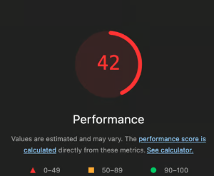
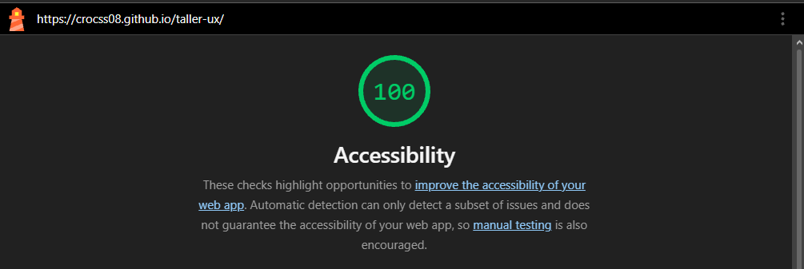

# tarea-ux
Formulario de inscripcion redisenado con principios de UX/UI
# Auditoría UX/UI: app de notas

Página publicada: https://TU-USUARIO.github.io/TU-REPO/

## 1. Heurísticas de Nielsen

| Heurística | Problema en la pantalla original | Solución aplicada |
|---|---|---|
| Visibilidad del estado | Al agregar o eliminar una nota no aparecía ningún aviso. | Mensaje visible tras cada acción («Nota agregada en Estudio.», «Nota eliminada.») con `role="status"`. |
| Coincidencia con el mundo real | Botones y textos con lenguaje técnico («OK», «Procesar»). | Textos de acción claros: «Agregar nota», «Eliminar», «Borrar todas las notas». |
| Control y libertad | Eliminar borraba al instante y no había forma de volver atrás. | Botón «Deshacer» durante 8 segundos y `confirm()` antes de borrar todas. |
| Prevención de errores | Se podían agregar notas vacías. | El botón «Agregar nota» está desactivado mientras el campo esté vacío; además se valida con `trim()`. |
| Reconocer, no recordar | Campo con solo `placeholder`; sin contador ni agrupación. | `label` visible en cada campo, contador de notas y notas agrupadas por categoría. |

## 2. Leyes de usabilidad

- **Fitts:** el botón «Agregar nota» ocupa todo el ancho (`flex: 1`) y mide 44 px; «Borrar todas» está separado y con estilo de peligro para no pulsarlo por error.
- **Hick:** la categoría tiene solo 3 opciones (Estudio, Personal, Trabajo), así la decisión es rápida.
- **Miller:** el formulario tiene solo 2 campos y la lista se divide en bloques por categoría, cada uno con pocos elementos.

## 3. Accesibilidad y principios visuales

- `label` en cada campo, `lang="es"`, un solo `h1`.
- Foco visible con `:focus-visible` (borde naranja de 3 px).
- Colores en variables CSS dentro de `:root`; texto con contraste mayor a 4.5:1.
- Botones y campos de al menos 44 px de alto; espaciado en múltiplos de 8.
- `aria-label` en cada botón «Eliminar» para indicar qué nota borra.

## 4. Lighthouse (Accesibilidad)

| Antes | Después |
|---|---|
|| |